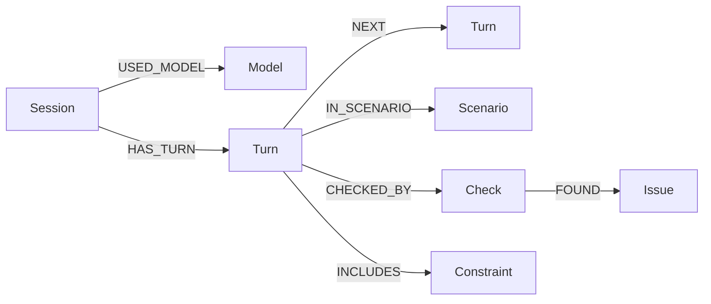

# Graph Schema

## Node properties

| Node | Properties | Meaning |
|---|---|---|
| `Session` | `id`, `title`, `model`, `created_at`, `note`, `turn_count` | One case in the regression transcript (`Q1`–`Q10`). |
| `Turn` | `id`, `index`, `user`, `scenario`, `task`, `post_valid`, `post_repaired`, `chars`, `first_token_s`, `total_s`, `eval_count`, `tokens_per_s`, `answer_preview` | One user/agent turn. `answer_preview` is a bounded preview, not the full answer. |
| `Check` | `id`, `valid`, `repaired` | The post-check attached to one turn. `repaired=true` means the architecture's repair path changed the answer. |
| `Issue` | `id`, `text` | One issue occurrence found by a check. The same issue text can occur on multiple turns and is kept as separate occurrences. |
| `Scenario` | `name` | The scenario label from the fixture, for example `routing`, `memory`, `crisis`. |
| `Constraint` | `text` | A short hard-constraint clause extracted deterministically from the user turn. |
| `Model` | `name` | The local model string, `qwen2.5:14b-instruct-q4_K_M`. |

## Relationship semantics

| Relationship | Meaning |
|---|---|
| `Session -[:USED_MODEL]-> Model` | The model recorded for the session. |
| `Session -[:HAS_TURN]-> Turn` | The turn belongs to the session. |
| `Turn -[:NEXT]-> Turn` | Conversation order within a session. |
| `Turn -[:IN_SCENARIO]-> Scenario` | The turn's scenario label. |
| `Turn -[:CHECKED_BY]-> Check` | The post-check ran on this turn. |
| `Check -[:FOUND]-> Issue` | The check found this issue occurrence. |
| `Turn -[:INCLUDES]-> Constraint` | A hard constraint extracted from the user turn. |

## Why this shape

The graph is deliberately small. It models the evidence a reviewer needs:

1. Which session and turn produced an answer.
2. Which scenario and constraint framed the turn.
3. Which post-check ran and whether it repaired the answer.
4. Which issue text was found, as a separate occurrence.

It does not store full model weights, chain-of-thought, or private production source.
